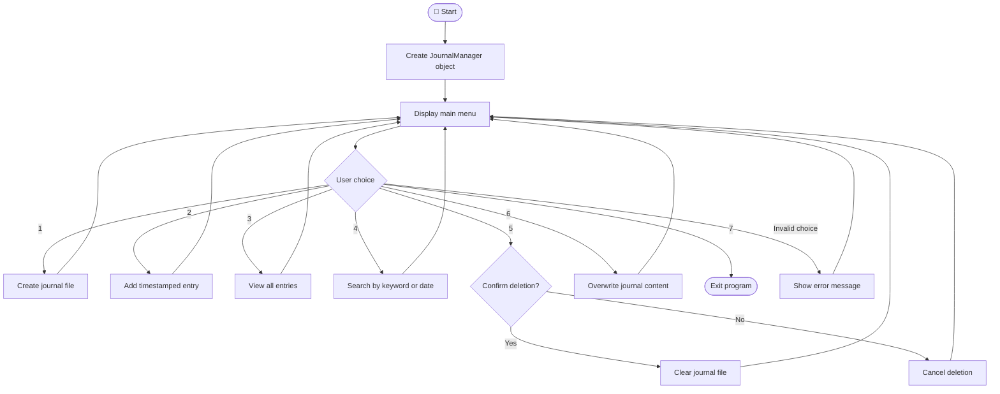
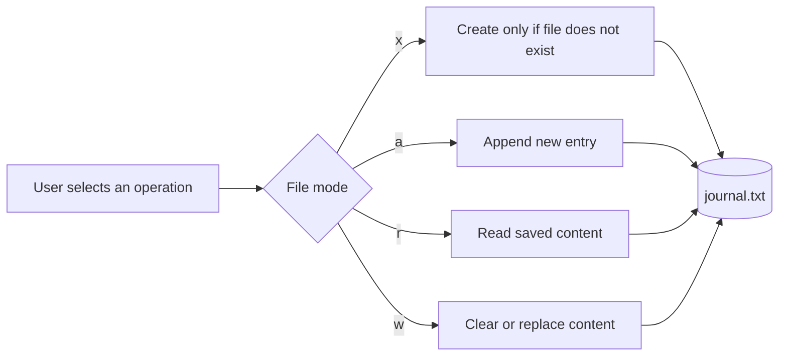

<div align="center">

<h3>📔 Personal Journal Manager</h3>

🐍 Python File Handling Project

Write your thoughts. Save your memories. Find them anytime. ✨

</div>


## 📌 About the Project

File Operator is a beginner-friendly Python project that demonstrates how files can be managed through a command-line menu. Users can store journal entries in a text file, view saved entries, search by a keyword or date, clear all entries, or replace the journal content.

Each new entry is saved with a timestamp so it is easier to identify when it was written.

## ✨ Features

|Feature              |Description                                                                    |
|---------------------|-------------------------------------------------------------------------------|
|🆕 Create Journal File|Creates `journal.txt` if it does not already exist.                            |
|✍️ Add New Entry      |Appends a journal entry with the current date and time.                        |
|📖 View All Entries   |Displays the entries saved in the journal file.                                |
|🔎 Search Entries     |Searches journal content using a keyword or date.                              |
|🗑️ Delete All Entries |Clears the journal after user confirmation.                                    |
|♻️ Overwrite Journal  |Replaces the existing content with new content.                                |
|🚪 Exit               |Closes the application safely.                                                 |
|🛡️ Error Handling     |Handles missing files, operating-system file errors, and keyboard interruption.|


## 🧰 Built With

<table>
  <tr>
    <th>Technology</th>
    <th>Description</th>
  </tr>
  <tr>
    <td>🐍 <b>Python</b></td>
    <td>Core programming language</td>
  </tr>
  <tr>
    <td>📂 <b>os</b></td>
    <td>Operating-system-related functionality</td>
  </tr>
  <tr>
    <td>🕒 <b>datetime</b></td>
    <td>Adds timestamps to journal entries</td>
  </tr>
  <tr>
    <td>📝 <b>File Handling</b></td>
    <td>Uses open(), read(), write(), and file modes</td>
  </tr>
  <tr>
    <td>🏗️ <b>Object-Oriented Programming</b></td>
    <td>Uses the JournalManager class and methods</td>
  </tr>
  <tr>
    <td>🛡️ <b>Exception Handling</b></td>
    <td>Handles errors using try, except, and specific file errors</td>
  </tr>
  <tr>
    <td>🔀 <b>Pattern Matching</b></td>
    <td>Uses match-case for menu selection</td>
  </tr>
</table>  

## 🔄 Application Workflow



## 🧠 How File Handling Works



|Mode |Used for           |Behaviour                                                         |
|-----|-------------------|------------------------------------------------------------------|
|`"x"`|Create file        |Creates a new file; raises `FileExistsError` if it already exists.|
|`"a"`|Add entry          |Adds new content at the end of the file.                          |
|`"r"`|View and search    |Reads existing content without changing it.                       |
|`"w"`|Delete or overwrite|Clears existing content before writing new content.               |


## output sample

```mermaid
flowchart TD
    A([Start]) --> B[Welcome Message]
    B --> C[Display Main Menu]
    C --> D[/Enter Your Choice/]
    D --> E{Select Option}

    E -->|1| F[Create Journal File]
    F --> F1[Display Success Message]
    F1 --> C

    E -->|2| G[Enter Journal Entry]
    G --> G1[Add Entry to File]
    G1 --> G2[Display Success Message]
    G2 --> C

    E -->|3| H[Read Journal File]
    H --> H1[Display All Entries]
    H1 --> C

    E -->|4| I[Enter Keyword or Date]
    I --> I1[Search Journal Entries]
    I1 --> I2[Display Search Results]
    I2 --> C

    E -->|5| J[Confirm Deletion]
    J --> K{Confirmation}
    K -->|Yes| L[Delete All Entries]
    K -->|No| C
    L --> C

    E -->|6| M[Enter New Journal Content]
    M --> M1[Overwrite Journal File]
    M1 --> M2[Display Success Message]
    M2 --> C


    E -->|7| N[Display Goodbye Message]
    N --> O([End])

    E -->|Invalid Choice| P[Display Error Message]
    P --> C


📸 Output Screenshot

<p>
  <a href="YOUR_SCREENSHOT_LINK_HERE">
    
  </a>
</p>

🎥 Demo Video

<p>
  <a href="YOUR_DEMO_VIDEO_LINK_HERE">
    
  </a>
</p>
